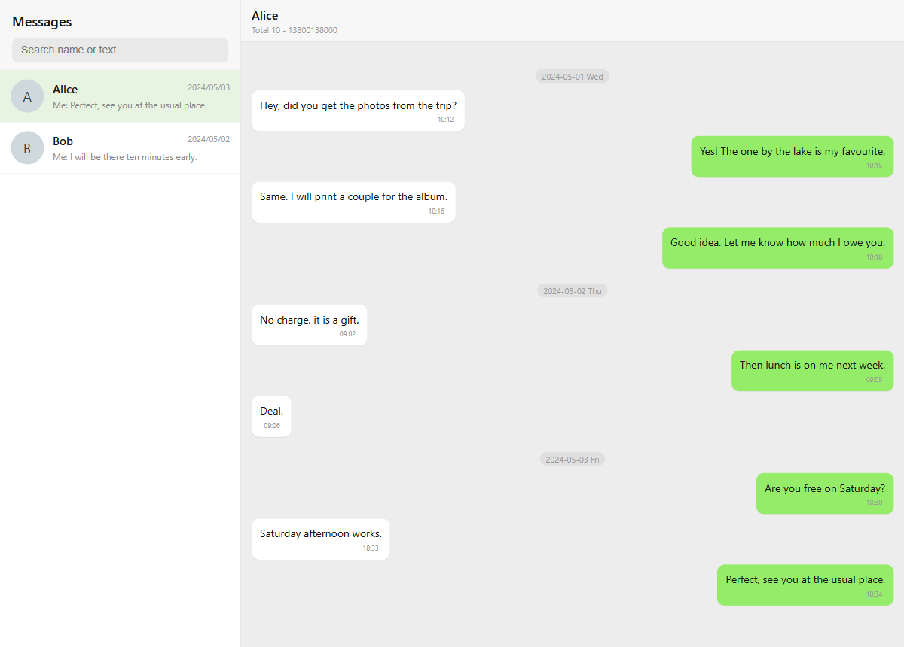

# Nokia Series 30+ backup recovery

[](https://pypi.org/project/nokia-ib-recovery/)
[](https://pypi.org/project/nokia-ib-recovery/)
[](https://github.com/Tokisaki-Galaxy/nokia-ib-recovery/actions/workflows/tests.yml)
[](LICENSE)

Recover SMS messages and contacts from the `.ib` backup files written by Nokia feature phones running Series 30+ firmware.



The phone's built in backup tool writes a folder named like `All-backup_01-05-2017_00-01-25` containing three files:

```
ibphone_head.in
phonebook.ib
sms.ib
```

These files are not a database and they are not encrypted. They are flat dumps of the phone's internal record store, with fixed size records and plain UTF-16 text. This project decodes them and exports CSV, TXT, HTML and vCard, using only the Python standard library.

## Quick start

```bash
pip install nokia-ib-recovery
nokia-ib all "All-backup_01-05-2017_00-01-25" -o output
```

Open `output/chat.html` in a browser. The CSV, TXT and vCard files are written to the same folder.

## What it does

- Parses `sms.ib`, one record per stored message.
- Detects incoming and outgoing messages.
- Decodes UCS-2 and GSM 03.38 bodies.
- Reassembles multipart messages using the concatenation UDH.
- Parses `phonebook.ib`, including multiple numbers per contact and the two name fields.
- Exports a phone style conversation browser grouped by contact.
- Reads the record table from the file header, so record counts and record sizes are not hard coded.

## Install

Python 3.8 or newer. No runtime dependencies.

### pip

```bash
pip install nokia-ib-recovery
```

### uv

```bash
uv tool install nokia-ib-recovery

# or run it without installing
uvx --from nokia-ib-recovery nokia-ib --help
```

### From source

```bash
git clone https://github.com/Tokisaki-Galaxy/nokia-ib-recovery.git
cd nokia-ib-recovery
pip install -e .
```

With uv, `uv run` creates the environment and installs the project on first use:

```bash
uv run nokia-ib --help
```

Running straight from the checkout without any install also works:

```bash
python -m nokia_ib --help
```

## Usage

Point the tool at the backup folder. It looks for `sms.ib` and `phonebook.ib` inside.

```bash
# Everything: messages, contacts and the conversation browser
nokia-ib all "All-backup_01-05-2017_00-01-25" -o output

# Messages only
nokia-ib sms "All-backup_01-05-2017_00-01-25" -o output

# Contacts only
nokia-ib contacts "All-backup_01-05-2017_00-01-25" -o output

# Conversation browser only
nokia-ib chat "All-backup_01-05-2017_00-01-25" -o output/chat.html
```

`backup` may also be the path to a single `.ib` file.

Example output:

```
messages: 659, received: 344, sent: 315
range: 2023-02-12 to 2025-08-16
contacts: 29, numbers: 33
written to output
```

### Output files

| File | Contents |
| --- | --- |
| `sms.csv` | Time, direction, address, resolved name, text, part count, offset |
| `sms.txt` | Plain text log grouped by day |
| `sms.html` | Chronological message view with search |
| `contacts.csv` | Name, raw name fields, all numbers, matching message count |
| `contacts.txt` | Plain text contact list |
| `contacts.vcf` | vCard 3.0, importable on a phone |
| `contacts.html` | Searchable contact table |
| `chat.html` | Phone style conversation list and chat view, grouped by contact |

`chat.html` is a single self contained file. The sidebar lists conversations sorted by the last message, the search box filters on names and message text, and the layout collapses to a single column on narrow screens.

### Custom names

Contacts are matched to messages by phone number. To override a name, pass a JSON file:

```json
{
  "8613800138000": "Alice",
  "12345": "Family"
}
```

```bash
nokia-ib all backup/ --aliases aliases.json -o output
```

## Format notes

The parsers read the record table from the file header, decode BCD addresses and UCS-2 or GSM 03.38 bodies, take the incoming timestamp from the embedded SMS PDU, and merge multipart messages through the concatenation UDH. All offsets and field layouts are documented in [docs/format.md](docs/format.md).

Two details are worth knowing before reading the notes.

Incoming and outgoing messages use different timestamps. Incoming messages carry the SMS centre time in the PDU. Outgoing messages store a seven byte binary time whose year is counted from 1980.

A 32 bit Unix style timestamp near the start of each record is exactly ten years early on the tested firmware, because the year was counted from 1980 but converted as if it started at 1970. The exporter ignores it.

The backup folder name is not a reliable date either. A phone that lost power may name the folder with its default clock, which is why a backup full of 2023 messages can be called `All-backup_01-05-2017_...`.

## Tested on

A single Nokia TA-127B backup with 776 message records and 29 contacts. The same container layout is likely used by other Series 30+ devices, but other models and firmware revisions have not been verified. If the header values differ, pass `--header-size` and open an issue with the header bytes.

## Limitations

- Deleted messages are not recoverable. The store is full and overwritten in place.
- Multipart reassembly relies on the concatenation UDH. Parts are matched by address, reference, total count and day.
- Messages with binary content, such as WAP pushes, are decoded as text and will look garbled.
- The phonebook name layout is inferred from one device. Contacts whose given name and family name are stored in separate fields are joined with the single character family name first.
- Only the fields listed in `docs/format.md` are decoded. Other parts of each record, such as the status flags and PDU leftovers, are ignored.

## Privacy

Backups contain personal messages and phone numbers. The `.gitignore` in this repository excludes `Backups/` and the default output folders so that real data is not committed by accident. Do not paste real `.ib` files, exported CSV files or screenshots of conversations into issues. When reporting a parsing problem, share only the header bytes and the offsets, or build a fake file with the same header values.

## Development

```bash
python -m unittest discover -s tests -t .
```

The test suite builds synthetic `sms.ib` and `phonebook.ib` files, so it does not need real backup data. The screenshot above was generated from such a synthetic file.

## Releasing

The version is derived from git tags by `setuptools-scm`. There is no version field in `pyproject.toml`.

This repository is already configured for PyPI trusted publishing. Forks need a pending publisher on PyPI with these values.

| Field | Value |
| --- | --- |
| PyPI project name | `nokia-ib-recovery` |
| Owner | `Tokisaki-Galaxy` |
| Repository | `nokia-ib-recovery` |
| Workflow name | `publish.yml` |
| Environment | `pypi` |

No API token is needed. The workflow authenticates with OpenID Connect through the `pypi` environment.

To publish, push a tag that starts with `v`:

```bash
git tag v0.1.0
git push origin v0.1.0
```

The tag starts `.github/workflows/publish.yml`, which runs the tests, builds the sdist and the wheel, and uploads them to PyPI. Tags such as `v0.1.0` and `v0.2.0rc1` map to valid Python versions automatically. A build without any tag produces a `0.0.x` development version and is not meant for release.

## Credits

The format notes started from these threads, then were corrected and extended against a real TA-127B backup:

- [Parsing/converting Nokia "Smart Feature OS" backup .ib files?](https://stackoverflow.com/questions/54009980/)
- [Backup/access SMS on Nokia 3310 3g/2017 from Linux PC?](https://superuser.com/questions/1389657/)

## License

MIT. See `LICENSE`.
